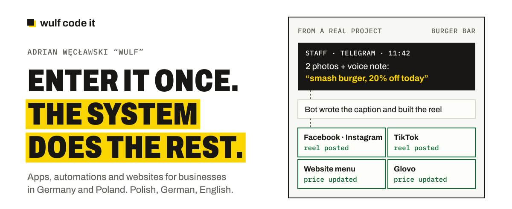
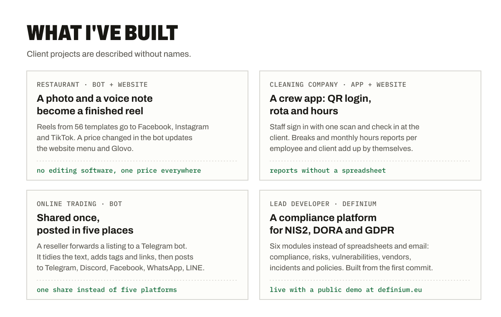
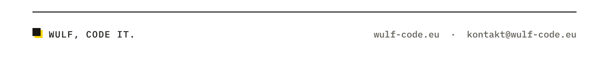

<picture>
  <source media="(prefers-color-scheme: dark)" srcset="./assets/hero-dark.svg">
  
</picture>

**I build apps and automations that take manual work off small businesses, plus websites in Polish, German and English.** Rotas, billing, menus, orders: you enter it once, and the system puts it where it needs to go.

<picture>
  <source media="(prefers-color-scheme: dark)" srcset="./assets/work-dark.svg">
  
</picture>

### Open source

- **[Raven](https://github.com/adrian-wulf/raven)**: a security scanner that catches common bugs before you ship. Go, MIT.
- **[Howlforge](https://github.com/adrian-wulf/howlforge)**: a self-hosted second brain. Capture ideas anywhere and keep them in a Markdown vault you own. Python, MIT.
- **[Wulf Lead.er](https://github.com/adrian-wulf/wulf-lead-er)**: a B2B lead radar for web agencies, with website audits. Python, MIT.

### Stack

TypeScript · Astro · Node.js · PHP · Python · Go · PostgreSQL · MariaDB · Docker · Telegram bots · PWAs

### Work with me

Describe what your team still does by hand, in a few sentences. I reply personally, in Polish, German or English.

[wulf-code.eu](https://wulf-code.eu) · [kontakt@wulf-code.it](mailto:kontakt@wulf-code.it) · [LinkedIn](https://www.linkedin.com/in/adrianwulf/)

<picture>
  <source media="(prefers-color-scheme: dark)" srcset="./assets/sign-dark.svg">
  
</picture>
